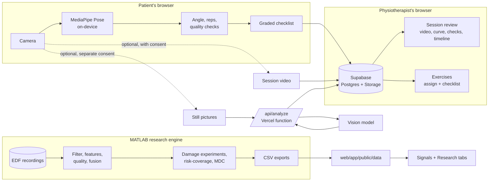

# Kinote

**Remote stroke-rehabilitation monitoring that knows when not to trust its own data.**

Kinote lets a stroke survivor practise a physiotherapist-assigned exercise at home while a camera tracks the arm in the browser. The physiotherapist reviews each session with a video, an angle curve, a graded checklist and the muscle and brain (EMG/EEG) signals, and every number is labelled by where it came from. Underneath sits a research question: **when should a home monitoring system refuse to answer?** The EEG/EMG research is done in MATLAB, and the product shows its results.

> **Research prototype, not a medical device.** Kinote gives no diagnosis, does not measure recovery, and does not replace a physiotherapist. The EEG and EMG shown in the web app are **replayed recordings from a research dataset**, not signals from the patient on screen. Real use would need suitable equipment, ethics approval and physiotherapist-led validation.

**Live demo:** https://healwithkinote.vercel.app
**Demo video:** https://youtu.be/KekPEGF2IeU

---

## Contents

1. [The problem](#1-the-problem)
2. [What Kinote does](#2-what-kinote-does)
3. [What is different about it](#3-what-is-different-about-it)
4. [How it works](#4-how-it-works)
5. [Tech stack](#5-tech-stack)
6. [Repository structure](#6-repository-structure)
7. [Source code guide](#7-source-code-guide)
8. [Database](#8-database)
9. [The research](#9-the-research)
10. [Getting started](#10-getting-started)
11. [Environment variables](#11-environment-variables)
12. [Testing](#12-testing)
13. [Deployment](#13-deployment)
14. [Privacy, ethics and limitations](#14-privacy-ethics-and-limitations)
15. [Project status](#15-project-status)
16. [Roadmap](#16-roadmap)
17. [Team and acknowledgements](#17-team-and-acknowledgements)

---

## 1. The problem

After a stroke, regular physiotherapy matters, but many survivors in settings like Nigeria cannot reach it. Physiotherapists are few, travel and inaccessible buildings make visits hard, and caregivers leave work to accompany patients. When patients practise at home, nobody can tell whether the exercises are done correctly.

Remote monitoring only helps if the data can be trusted, and data recorded outside a clinic is often poor. A bad camera angle, a loose electrode or mains interference can look like progress or decline when function has not changed. Most tools show a number and say nothing about whether to believe it.

## 2. What Kinote does

**For the patient or caregiver**
- Sign up, then see today's exercise, instructions, a demonstration video and the checks the physiotherapist will grade.
- Practise with live camera tracking in the browser: elbow angle, repetition count, and a "keep your arm in view" warning.
- Choose whether a video of the session is saved for the physiotherapist. Nothing is recorded unless they agree.
- Optionally agree to an AI look at a few still pictures for the visual checks.
- Follow progress and message the physiotherapist.

**For the physiotherapist** (admin account)
- See every patient who signed up, and pick any patient and any session.
- Assign an exercise: repetitions, instructions, a video (YouTube link or upload) and a checklist.
- Review a session: video, angle curve with each repetition marked, a repetition-by-repetition table, each check graded, a session timeline, and a written note on what to change next.
- Follow muscle and brain signal trends with their uncertainty, and a **Research** tab with the evidence behind what the dashboard says.
- Message patients.

**Everywhere:** each figure is tagged **Measured**, **Model estimate**, **AI-observed (unverified)** or **Replayed recording**, and the system says **can't tell** when the evidence is too poor.

## 3. What is different about it

Camera-based home rehabilitation, patient and clinician apps, EMG/EEG features, signal-quality scores and abstention are all established ideas. Kinote does not claim to have invented any of them. What it contributes:

- **One reliability idea across three sources** (camera, muscle, brain) in a single rehabilitation product, carried from the live "keep your arm in view" warning to the doctor's "can't tell" rows.
- **An evaluation that never counts a withheld answer as correct.** Errors, withheld share and coverage are reported separately, and damage types the system was not designed around are tested separately.
- **Negative results are reported.** Quality scores detect damage well but the underlying decision is still wrong on roughly one clean cue in four, and no quality score can see those errors.
- **The research changed the product.** Repeat recordings in one session varied far more than cue-count chance alone, so the session-to-session verdicts shown to doctors were corrected before anyone relied on them.
- **Honest labelling.** Replayed data, simulated damage and unverified AI output are marked on every screen.

## 4. How it works



**Session flow**
1. The doctor assigns an exercise. The checks are stored with it.
2. The patient opens Home and Session. `SessionTracker` loads the MediaPipe model, reads the camera, and for each frame computes the elbow angle, a shoulder-tilt estimate and a quality flag.
3. At the end, `analyzeSession` counts repetitions, range of motion and per-repetition measurements. If fewer than 60% of frames were tracked, **no numbers are reported**.
4. `evaluateCriteria` grades each measurable check as met, partly met, not met or can't tell, with evidence.
5. One row is saved to `sessions`, with the metrics, the angle curve and the graded checks. If the patient consented, the video is uploaded to private storage, and typed visual checks are sent as a few stills to a server function that calls a vision model.
6. The doctor's **Sessions** tab reads that row. Videos are opened through expiring signed links.

**Research flow (MATLAB)**
EDF recording → `loadEdfRecording` → `preprocessRecording` (filters) → `extractCueFeatures` and quality scores → `fuseCues` (reliability-weighted fusion with abstention) → experiments (`runSweep`, `runHeldOut`, `runRiskCoverage`, `runRiskControl`, `runMDC`) → CSV files in `web/data` → copied to `web/app/public/data` → drawn by the website.

## 5. Tech stack

| Layer | Tools | Used for |
|---|---|---|
| Web app | React, Vite, plain CSS | Landing page, patient app, doctor app |
| Pose tracking | MediaPipe Pose Landmarker (`@mediapipe/tasks-vision`), self-hosted model files | On-device shoulder, elbow, wrist tracking |
| Video | Browser MediaRecorder API | Optional consented session video |
| Backend | Supabase: Postgres, Auth, Row Level Security, Storage | Accounts, roles, data, private video, signed links |
| Serverless | Vercel Functions (`web/app/api`) | Server-side call for the optional visual check, so the API key never reaches the browser |
| Hosting and CI | Vercel, GitHub | Deploy on push |
| Charts and data | Hand-drawn SVG, PapaParse | Trend, timeline and research charts; reading exported CSVs |
| Research engine | MATLAB Online, MATLAB Drive | Shared environment and all EEG/EMG analysis |
| MATLAB toolboxes | Signal Processing, Computer Vision (+ Deep Learning HRNet keypoint add-on), Statistics and Machine Learning, core MATLAB, `matlab.unittest` | See below |
| Vision model (optional) | Configured by environment variable | Judging typed visual checks from a few stills, marked unverified |

**What each MATLAB part is used for**

| MATLAB | Used for |
|---|---|
| `edfinfo`, `edfread` | Reading the EDF EEG/EMG recordings and their cue annotations |
| `butter`, `filtfilt` | Zero-phase band-pass filters: EEG 1 to 40 Hz, EMG 20 to 200 Hz |
| `iirnotch` | Removing 50 Hz mains hum |
| `bandpower` | EEG 8 to 12 Hz and 13 to 30 Hz band power; spectral quality checks |
| `findpeaks`, `movmean` | Repetition counting and smoothing |
| `hrnetObjectKeypointDetector`, `webcam` | The first pose-tracking prototype and its protractor accuracy check |
| `prctile`, `groupsummary`, `betaincinv`, tables | Evaluation statistics, intervals and error-rate bounds |
| `matlab.unittest` | Unit tests |
| `jsonencode` | Saving the parameters of every run for reproducibility |

## 6. Repository structure

```
kinote/
├── README.md
├── setupProject.m            Adds every project folder to the MATLAB path
├── checkEnvironment.m        Lists which toolboxes and features are available
├── config/                   Local settings (dataroot.txt is git-ignored)
├── biomedical/audit/         EEG/EMG pipeline, fusion, experiments (MATLAB)
├── fusion/                   Reserved for fusion code (currently in biomedical/audit)
├── vision/                   MATLAB camera-angle prototype and its tests
├── apps/                     MATLAB backup apps (PatientApp, DoctorApp)
├── database/                 MATLAB CSV data store used by the backup apps
├── integration/              Data contract and replay adapter
├── tests/                    MATLAB unit tests
├── docs/                     Decisions log and SQL
│   └── sql/                  Supabase setup files, run in numeric order
├── research_results/         CSV, PNG and run-info outputs from the experiments
├── research_cache/           Large intermediate files (git-ignored)
└── web/
    ├── data/                 Exported research CSVs (source copies)
    └── app/                  The deployed web application
        ├── api/              Vercel serverless function
        ├── public/
        │   ├── data/         CSVs the website reads (+ signals/)
        │   └── mediapipe/    Self-hosted pose model and WASM files
        └── src/              React source (see section 7)
```

Raw `.edf` recordings and videos are **not** stored in Git. They live in a shared MATLAB Drive folder.

## 7. Source code guide

### 7.1 Web app (`web/app/src`)

| File | What it does |
|---|---|
| `main.jsx`, `App.jsx` | Entry point. Loads the session, fetches the profile, and routes: signed out → landing or sign-in, patient → `PatientApp`, admin → `DoctorApp` (with a doctor/patient view switch) |
| `Landing.jsx`, `landing.css` | Public landing page |
| `Auth.jsx` | Sign-in and sign-up. Every sign-up is a patient; admin is set manually in the database |
| `Shell.jsx`, `nav.css` | Top bar on desktop, slide-out menu on phones, account menu |
| `PatientApp.jsx` | Home, Session, Progress, Messages |
| `DoctorApp.jsx` | Sessions, Exercises, Muscle and brain signals, Research, Messages |
| `SessionTracker.jsx` | Live camera tracking, repetition feedback, optional video recording, saves the session, optional still-picture check |
| `tracking.js` | Pure logic: `jointAngle`, `analyzeSession` (repetitions, range of motion, per-repetition metrics, quality rules, 60% visibility rule) |
| `criteria.js` | The catalogue of checks a doctor can set and `evaluateCriteria`, which grades each one |
| `visualCheck.js` | Captures still pictures and calls `/api/analyze` |
| `ExercisesView.jsx`, `ExerciseGuide.jsx` | Assign exercises with checks and video; show the guide video (YouTube embed or private upload) |
| `SessionReview.jsx` | Pick a patient's session; video, check table, per-repetition table, checks across sessions, doctor's note and plan, agree/disagree on AI rows |
| `SessionDetail.jsx` | Session video player and angle curve |
| `SessionTimeline.jsx`, `TimeSeriesChart.jsx` | Camera angle plus EMG and EEG charts over time |
| `SessionsView.jsx` | Repetitions-per-session chart and session table |
| `SignalsView.jsx`, `TrendChart.jsx` | EEG/EMG trends, summary text, session comparison, cue table, clean and degraded replay |
| `ResearchView.jsx`, `ExperimentView.jsx` | Research tab: headline numbers, session-change table, collapsible detail |
| `MessagesView.jsx` | Doctor and patient messages |
| `data.js` | CSV loader (PapaParse) with caching |
| `constants.js`, `supabaseClient.js` | Default exercise, display names, Supabase client |
| `index.css`, `charts.css` | Base styles and chart styles |

`web/app/api/analyze.js` and `_lib.js` form the serverless function. It verifies the caller's login, checks that the session is theirs and not yet analysed, calls the vision model with a strict JSON form, validates the answer (anything unusable becomes "can't tell"), and stores it through a database function that only the owner can call, once.

### 7.2 MATLAB (`biomedical/audit`)

| File | What it does |
|---|---|
| `loadEdfRecording.m` | Reads one EDF file into samples × channels, with sampling rate, labels and events |
| `preprocessRecording.m` | Finds the motor EEG and forearm EMG channels by name (layouts differ between files), filters them |
| `extractCueFeatures.m` | For each cue: EMG RMS ratio and EEG band-power change, response window against a 2 s baseline |
| `computeCueQuality.m`, `computeCueQuality2.m` | Quality scores v1 and v2 (v2 takes the worst of several named checks) |
| `fuseCues.m` | Reliability-weighted EMG/EEG fusion that can say can't tell; ordinary equal-weight fusion as a baseline |
| `sessionInsights.m` | Template-based plain-language summary, tagged Measured or Model estimate |
| `degradeRecording.m`, `damageExtra.m`, `damageAny.m`, `sweepConditions.m` | Simulated damage: loose electrode, muscle noise, brain spikes, electrode pops, mains hum, weak electrode, brain noise |
| `runSweep.m` | Damages every recording eight ways and caches the features (resumable) |
| `runHeldOut.m`, `runHeldOutCalibrated.m` | Damage detection and outcomes per damage type |
| `runRiskCoverage.m` | Error against share of cues answered, with resampling intervals |
| `runRiskControl.m`, `riskControlThreshold.m`, `clopperPearsonUpper.m` | Choosing an abstention cut-off for a target error rate, tested on a held-out patient |
| `runMDC.m`, `applyMDCToWeb.m` | Minimal detectable change from repeat recordings; rewrites the website's session verdicts |
| `labelCues.m`, `cueScores.m`, `buildScored.m`, `aucScore.m` | Shared analysis helpers |
| `buildInventory.m`, `runAllFeatures.m`, `makeSessionSummary.m`, `makeDegradedDemo.m`, `exportForWeb.m`, `exportSignalTimelines.m` | Inventory, feature table, exports for the website |
| `countReps.m`, `flatnessScore.m`, `runTiltExperiment.m` | Repetition counting as a testable function; out-of-plane check; protractor tilt test |
| `pairedOnset.m`, `runPairedDemo.m` | Camera-versus-EMG onset lag for future real hardware, with a synthetic demo |
| `researchPaths.m`, `saveRunInfo.m`, `runAllResearch.m` | Paths, run parameters for reproducibility, one-command runner |

### 7.3 Other MATLAB folders

- `vision/`: `jointAngle.m`, `analyzeElbowVideo.m` (angle, repetitions, range of motion, status), and the step-by-step scripts used to build and check it.
- `apps/`, `database/`: the earlier MATLAB patient and doctor apps and their CSV store. Kept as a working backup of the demo.
- `integration/`: `makeRecording.m` (the data contract any source must produce) and `ReplayAdapter.m` (feeds a recording as if live; a real device adapter would expose the same `getNextSegment()`).
- `tests/`: `KinoteTests.m`, `PairedTests.m`.

## 8. Database

Supabase Postgres with Row Level Security on every table.

| Table | Purpose |
|---|---|
| `profiles` | One row per account: email, name, role (`patient` or `admin`), dataset patient shown for replayed signals |
| `sessions` | One row per exercise session: repetitions, range of motion, visibility, status, angle curve, per-repetition metrics, graded checks, AI observations, video path |
| `exercises` | Assigned exercise: repetitions, instructions, video link or upload, checklist |
| `messages` | Doctor and patient messages |
| `session_reviews` | Doctor's note, next-instruction plan, and agree/disagree on AI rows |
| `session_signals` | EMG/EEG recorded together with a session (for real hardware) |

Storage buckets: `clips` (session videos) and `exercise-videos`, both private.

**Rules enforced in the database:** a patient can read and write only their own rows; only an admin reads everyone's and writes as the doctor; nobody can change a role from the app; videos are readable only by their owner and the admin, through expiring signed links; the AI result can be stored only by the session's owner, and only once.

Setup SQL is in `docs/sql/`. Run the files in numeric order.

## 9. The research

**Data.** 94 EDF recordings from four patients (500 Hz, EEG and forearm EMG, 12 cues per recording, 1,127 cues in total). Channel names differ between files, so channels are located by name. _Dataset name and source: add here._

**Pipeline.** EEG band-pass 1 to 40 Hz and EMG 50 Hz notch plus 20 to 200 Hz band-pass (zero-phase Butterworth). For each cue, EMG RMS and EEG 8 to 12 Hz and 13 to 30 Hz power are compared across a 2 s baseline and a 3 s response window. Evidence is standardised per patient using that patient's non-movement cues, then combined weighted by quality. If trust falls below the cut-off, the cue is withheld.

**Evaluation.** Eight conditions (clean plus seven simulated damage types, 25% of cues damaged per recording). Withheld cues are never counted as correct. Intervals come from resampling whole recordings. Error-rate cut-offs are chosen on three patients and tested on the fourth.

**Main results** (see the website's Research tab and `research_results/`)

| Finding | Result |
|---|---|
| Loose electrode | Ordinary fusion wrong on 47% of damaged cues; Kinote wrong on 0.4% by withholding 99% |
| Base decision | Wrong on about 28% of clean cues, and quality scores barely lower this |
| Quality score v1 | Detects flat and loud muscle signals (AUC up to 0.99) but misses electrode pops (0.60) and brain-signal damage (about 0.68) |
| Quality score v2 | Detects those better (up to 0.97) but is weaker on a flat signal; its worst-check form cannot be calibrated |
| Error-rate guarantee | No cut-off met a 15% or 20% target on a held-out patient |
| Session change | Repeat recordings varied about 2.6 times more than cue-count chance, so a change in attempt rate needs about 42 points to count; 3 of 18 comparisons were corrected to "no reliable change" |
| Camera angle (MATLAB version) | Ten static readings against a protractor, one person: mean difference +0.3°, typical error 1.8°, worst 4.0° |

**Limits.** Damage is simulated, and the v2 checks were written with these damage types in view, so held-out results are optimistic. Four patients only. Labels come from the cue protocol, not confirmed movements. The camera and the EEG/EMG come from different people. The browser tracker has not yet been checked against a protractor.

Every run saves its date, MATLAB version and parameters next to its output (`*_runinfo.json`). Decisions and their status (guess, set, measured) are in `docs/decisions.md`.

## 10. Getting started

### Web app

```bash
git clone https://github.com/ayatullah-hanif/kinote.git
cd kinote/web/app
npm install
```

1. Create a Supabase project. Run the SQL files in `docs/sql/` in order.
2. Create `web/app/.env.local` (see [section 11](#11-environment-variables)).
3. Make sure `public/mediapipe/` holds `pose_landmarker_lite.task` and the `wasm` folder from `node_modules/@mediapipe/tasks-vision`.
4. Run:
```bash
npm run dev
```
5. Sign up, then make that account the doctor in the Supabase SQL editor:
```sql
update public.profiles set role = 'admin' where email = 'you@example.com';
```
Sign up a second account for the patient. The camera needs HTTPS or `localhost`.

The visual-check function runs only on Vercel (or `vercel dev`), because `/api` is served there.

### MATLAB research code

1. Open MATLAB Online (or desktop) and run, from the repo root:
```matlab
setupProject
checkEnvironment
```
2. Put the `.edf` recordings in `biomedical/audit/` (git-ignored) or point `config/dataroot.txt` at your shared data folder.
3. Run the pipeline and experiments:
```matlab
runAllFeatures        % feature table for every recording
runSweep              % heavy: damages and re-processes everything (resumable)
runAllResearch        % held-out, risk-coverage, risk-control, MDC, then unit tests
exportSignalTimelines % time series for the session timeline
```
4. Copy the CSVs from `web/data` to `web/app/public/data` and push.

Always run `setupProject` first in a new session, or functions in other folders will not be found.

## 11. Environment variables

| Variable | Where | Purpose |
|---|---|---|
| `VITE_SUPABASE_URL` | `.env.local`, Vercel | Supabase project URL |
| `VITE_SUPABASE_ANON_KEY` | `.env.local`, Vercel | Public (anon) key. **Never use the `service_role` key** |
| `ANTHROPIC_API_KEY` | Vercel only | Server-side key for the optional visual check. No `VITE_` prefix |
| `ANTHROPIC_MODEL` | Vercel, optional | Overrides the default model |

`.env.local` is git-ignored. Server secrets must never carry the `VITE_` prefix, because those values are bundled into the browser.

## 12. Testing

```matlab
runtests("tests/KinoteTests.m")   % angle, repetition counting, quality, damage, fusion, abstention
runtests("tests/PairedTests.m")   % camera-versus-EMG onset lag
```

```bash
cd web/app
npm run build                      # must pass before pushing; Vercel runs the same command
```

File names are case-sensitive on Vercel. Check them with `git ls-files web/app/src`.

## 13. Deployment

Pushing to `main` redeploys on Vercel (project root `web/app`). Set the environment variables above in Vercel, then redeploy, because they only apply to new builds. `web/app/vercel.json` gives the visual-check function up to 60 seconds.

## 14. Privacy, ethics and limitations

- **Consent.** Session video is saved only if the patient ticks a box. The still-picture check has a separate tick box, because pictures leave the device for an external AI service.
- **Storage.** Videos are in private buckets, readable only by the owner and the doctor through expiring links.
- **Data.** The dataset is a public research dataset. No real patient data should be entered into the demo.
- **Claims.** Kinote does not diagnose, predict recovery or change a therapy programme. It describes recordings and says when a change is within normal variation.
- **AI output** is marked unverified, may be wrong, and is never used for numbers or clinical conclusions. Free-tier AI services may retain and use submitted content; use paid or compliant services for any real patient.
- **Real use** would need ethics approval, suitable equipment, patient and caregiver training, and supervised validation.

## 15. Project status

**Built and used**
- Landing page, accounts and roles, patient and doctor apps, messaging, exercise assignment with video, live browser tracking, saved video review, deployment.
- MATLAB pipeline, quality scores, fusion, damage experiments, the four analyses, and the website's Signals and Research tabs.

**Written, awaiting verification** _(update this list as items are checked)_
- Exercise checks and session review, session timeline, and the AI visual check.
- MATLAB unit tests and the tilt experiment.
- A protractor check of the browser tracker.
- Measuring the AI visual check's accuracy against scripted clips.

## 16. Roadmap

- Record real EEG/EMG together with the camera, and use `pairedOnset.m` on real paired data.
- Validate the browser tracker against a protractor, and the visual check on scripted clips.
- Improve the base EMG/EEG decision (for example EMG-only versus fusion), and soften the v2 quality checks so they can be calibrated.
- Add a second exercise, such as shoulder flexion, and a hip-visible mode for trunk lean.
- Ethics review and a clinician-led pilot.

## 17. Team and acknowledgements

- **Ayatullah Hanif**: computer vision, EEG/EMG pipeline, fusion, research experiments, web application
- **Nafisat**: dataset download and audit
- **Aisha**: application and database design

Built with MATLAB, MediaPipe, React, Supabase and Vercel. https://figshare.com/articles/dataset/Multisession_fNIRS-EEG_data_of_Post-Stroke_Motor_Recovery_Recordings_During_Intact_and_Paretic_Hand_Movements/28904942

## License

MIT
